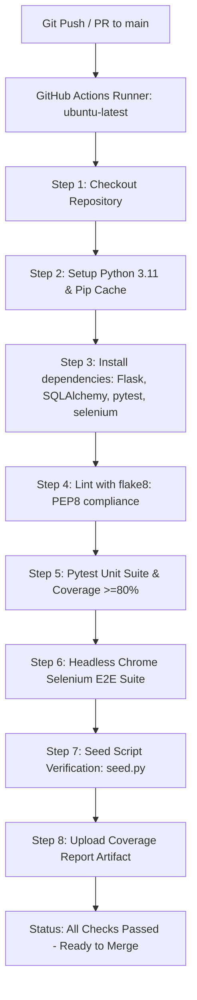

# Self-Learned Tool Study: GitHub Actions vs Jenkins

**Course:** RUET CSE 3206 Software Engineering Sessional  
**Project:** ClinicCare — Clinic Appointment and Billing System  
**Author:** 2203004  
**Date:** November 27, 2026  

---

## 1. Context and Problem Statement

Continuous Integration and Continuous Deployment (CI/CD) automates building, linting, testing, and deployment to guarantee that every commit pushed to source control satisfies software quality, functional correctness, and regression-free standards. In ClinicCare, our strict requirements demand:
1. Automated PEP8 compliance enforcement (`flake8`).
2. Unit testing with strict branch coverage tracking $\ge 80\%$ (`pytest`, `pytest-cov`, `pytest-mock`).
3. Cross-functional headless browser end-to-end (E2E) testing (`Selenium` with Headless Google Chrome).
4. Verifiable database migration and seeding validation (`seed.py`).

To realize this, we conducted an empirical evaluation between **Jenkins** (the traditional self-hosted automation server) and **GitHub Actions** (the modern cloud-native declarative CI/CD engine).

---

## 2. Comparative Analysis Matrix

| Evaluation Criterion | Jenkins | GitHub Actions | Selected for ClinicCare |
| :--- | :--- | :--- | :--- |
| **Hosting Model** | Self-hosted master/agent VMs requiring continuous OS, JVM, and plugin security patching. | Managed cloud runner infrastructure (Ubuntu, macOS, Windows) provisioned on-demand. | **GitHub Actions** |
| **Setup & Overhead** | Requires Java runtime, standalone daemon setup, webhook networking (e.g. ngrok or reverse proxy). | Zero infrastructure setup. Active immediately upon committing `.github/workflows/*.yml`. | **GitHub Actions** |
| **Configuration Syntax** | Groovy-based `Jenkinsfile` (declarative or scripted), prone to plugin classpath divergence. | Clean declarative YAML with standardized actions (`actions/checkout`, `actions/setup-python`). | **GitHub Actions** |
| **Headless Chrome E2E** | Manual Chrome/Chromedriver installation and xvfb display management on server nodes. | Pre-installed Google Chrome and headless execution out of the box on `ubuntu-latest`. | **GitHub Actions** |
| **GitHub CLI / PR Integration** | External GitHub plugin required; checks must be polled or triggered via webhook tokens. | Native integration with pull requests, inline annotations, and PR checks out of the box. | **GitHub Actions** |
| **Resource Cost** | Persistent idle server resource consumption and operational maintenance costs. | Generous free tier for public and educational repositories with zero idle overhead. | **GitHub Actions** |

---

## 3. Rationale for Selecting GitHub Actions

1. **Native GitHub Ecosystem Integration:** GitHub Actions executes directly alongside pull requests, enforcing that pull requests into `main` cannot be merged without passing all unit and Selenium checks.
2. **Standardized Declarative Configuration:** A single YAML workflow (`.github/workflows/ci.yml`) fully defines the build matrix, dependencies, linting, test execution, and artifact generation.
3. **Headless Chrome Support:** GitHub's `ubuntu-latest` virtual environments come equipped with Google Chrome, allowing headless Selenium suites to execute reliably without manual X11 display emulator workarounds.
4. **Reproducibility:** Fresh containerized environments are instantiated for every run, eliminating the "works on my server agent" configuration drift common in Jenkins deployments.

---

## 4. Pipeline Architecture for ClinicCare

